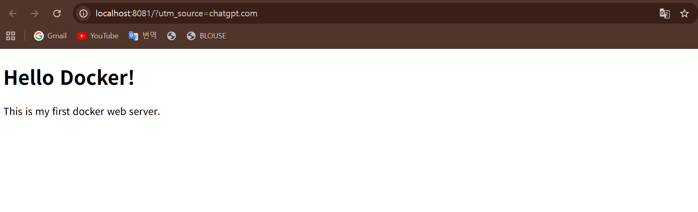
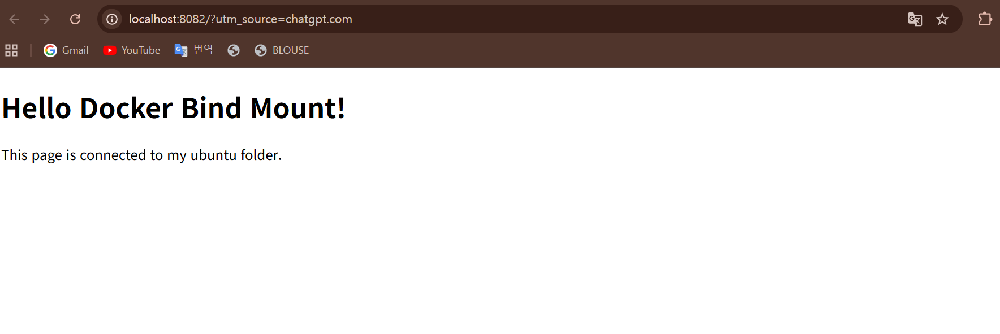
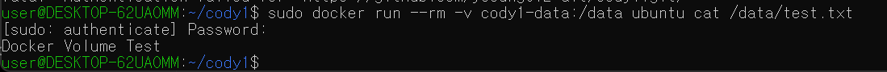

# Linux & Docker 실습 프로젝트

## 1. 프로젝트 소개

Linux 기본 명령어와 Docker의 주요 기능을 직접 실습하고, Git과 GitHub를 이용해 학습 과정을 기록하는 프로젝트입니다.

**실습 목표**
- Linux 파일 및 디렉터리 관리 명령어 익히기
- 파일 접근 권한 이해하기
- Docker 이미지와 컨테이너 실행하기
- Dockerfile을 이용한 웹 서버 구축하기
- Bind Mount와 Volume의 차이 이해하기
- Git과 GitHub를 이용한 버전 관리

## 2. 실습 환경

| 구분 | 사용 환경 |
|---|---|
| 운영체제 | Windows + WSL2 |
| Linux | Ubuntu |
| 컨테이너 | Docker Desktop |
| 웹 서버 | Nginx |
| 편집기 | Visual Studio Code |
| 버전 관리 | Git / GitHub |

## 3. 프로젝트 구조

```text
cody1/
├── README.md
├── .gitignore
├── practice/
│   ├── hello.txt
│   ├── hello_backup.txt
│   └── perdem/
├── webserver/
│   ├── Dockerfile
│   └── index.html
└── bindmount/
    └── index.html
```

## 4. Linux 기본 명령어 실습

### 파일 및 디렉터리 관리

```bash
mkdir practice
cd practice
touch hello.txt
echo "hello Linux!" > hello.txt
cat hello.txt
cp hello.txt hello_copy.txt
mv hello_copy.txt hello_backup.txt
ls -l
```

파일 생성, 내용 출력, 복사, 이름 변경 등의 명령어를 실습했습니다.

### 파일 권한 변경

```bash
chmod 755 hello.txt
chmod 644 hello.txt

mkdir perdem
chmod 700 perdem
ls -ld perdem
```

`chmod`를 이용하여 소유자, 그룹, 기타 사용자에게 부여되는 읽기(r), 쓰기(w), 실행(x) 권한을 확인했습니다.

## 5. Docker 기본 실습

### Hello World 컨테이너 실행

```bash
sudo docker run hello-world
```

Docker가 정상적으로 설치되고 실행되는지 확인했습니다.

### Ubuntu 컨테이너 실행

```bash
sudo docker run -it --name ubuntu-test ubuntu bash
cat /etc/os-release
exit
```

Ubuntu 컨테이너에 접속하여 운영체제 정보를 확인하고 종료했습니다.

## 6. Dockerfile을 이용한 웹 서버 구축

`webserver/Dockerfile`을 작성했습니다.

```dockerfile
FROM nginx:alpine
COPY index.html /usr/share/nginx/html/index.html
```

Docker 이미지 빌드:

```bash
cd ~/cody1/webserver
sudo docker build -t cody1-web .
```

컨테이너 실행:

```bash
sudo docker run -d --name cody1-web-container -p 8081:80 cody1-web
```

브라우저에서 `http://localhost:8081`로 접속하여 웹 페이지가 정상적으로 표시되는 것을 확인했습니다.

### 웹 서버 실행 결과



## 7. Docker Bind Mount 실습

Ubuntu의 `bindmount` 폴더를 Nginx 컨테이너의 웹 페이지 디렉터리에 연결했습니다.

```bash
sudo docker run -d \
  --name bindmount-test \
  -p 8082:80 \
  -v /home/user/cody1/bindmount:/usr/share/nginx/html:ro \
  nginx:alpine
```

VS Code에서 `bindmount/index.html`을 수정하고 저장한 뒤, `http://localhost:8082`를 새로고침했습니다.

### Bind Mount 실행 결과



**실습 결과:** 이미지를 다시 빌드하지 않아도 수정한 HTML 내용이 웹 페이지에 반영되는 것을 확인했습니다.

## 8. Docker Volume 실습

### Volume 생성

```bash
sudo docker volume create cody1-data
sudo docker volume ls
```

### 컨테이너에서 파일 저장

```bash
sudo docker run -it --name volume-test -v cody1-data:/data ubuntu bash
```

컨테이너 내부에서:

```bash
echo "Docker Volume Test" > /data/test.txt
cat /data/test.txt
exit
```

### 컨테이너 삭제 후 데이터 확인

```bash
sudo docker rm volume-test
sudo docker run --rm -v cody1-data:/data ubuntu cat /data/test.txt
```

출력 결과:

```text
Docker Volume Test
```

**실습 결과:** 기존 컨테이너를 삭제한 후에도 Docker Volume에 저장한 데이터가 유지되는 것을 확인했습니다.

### Docker Volume 실행 결과



## 9. Git 및 GitHub

Git 저장소를 초기화하고 `main` 브랜치에서 프로젝트 파일을 관리했습니다.

```bash
git init
git branch -m main
git add .
git commit -m "Initial commit: Linux and Docker practice"
```

GitHub 원격 저장소 연결:

```bash
git remote add origin https://github.com/yseung012-alt/cody1.git
git remote -v
```

## 10. 오류 해결 과정 (Troubleshooting)

### Docker 명령어 실행 오류

**문제:** Ubuntu에서 Docker 명령어를 찾지 못하거나 Docker 소켓에 접근할 권한이 없었습니다.

**해결:** Docker Desktop의 WSL Integration을 활성화하고, 필요한 경우 `sudo docker`로 실행했습니다.

### 웹 서버 포트 연결 오류

**문제:** 웹 서버 컨테이너를 실행할 때 호스트 포트 `8080` 연결에 실패했습니다.

**해결:** 생성된 컨테이너를 정리한 뒤 호스트 포트를 `8081`로 변경하여 실행했습니다.

### Bind Mount 경로 오류

**문제:** 컨테이너 내부 연결 경로가 절대 경로가 아니어서 실행에 실패했습니다.

**해결:** `/usr/share/nginx/html`처럼 `/`로 시작하는 절대 경로로 수정했습니다.

### GitHub Push 인증 및 권한 오류

**문제:** `git push` 실행 시 인증 오류와 `403 Permission denied` 오류가 발생했습니다.

**원인:** GitHub는 일반 계정 비밀번호를 이용한 Git 인증을 지원하지 않으며, 처음 발급한 Personal Access Token(PAT)에 저장소 쓰기 권한이 없었습니다.

**해결:**
1. GitHub에서 Fine-grained Personal Access Token을 발급했습니다.
2. Repository access를 `Only select repositories`로 변경하고 `cody1`을 선택했습니다.
3. Repository permissions의 Contents 권한을 `Read and write`로 설정했습니다.
4. 수정한 토큰으로 다시 인증하여 `git push -u origin main`을 성공적으로 실행했습니다.

**결과:** README.md와 실습 파일을 GitHub 원격 저장소에 업로드했습니다.

## 11. 실습 결과 스크린샷

추후 실습 결과를 확인할 수 있는 스크린샷을 추가할 예정입니다.

- Docker Hello World 실행 결과
- Nginx 웹 서버 접속 화면
- Bind Mount HTML 수정 결과
- Docker Volume 데이터 유지 확인 결과

## 12. 학습 내용

이번 실습을 통해 Linux 환경에서 파일과 권한을 관리하는 방법을 익혔습니다.

Docker를 이용해 컨테이너를 실행하고, Dockerfile로 이미지를 직접 빌드했으며, Bind Mount와 Volume을 활용해 파일을 연결하고 데이터를 유지하는 방법을 확인했습니다.

또한 Git을 이용해 실습 파일의 변경 이력을 관리하고 GitHub에 프로젝트를 정리하는 과정을 학습했습니다.