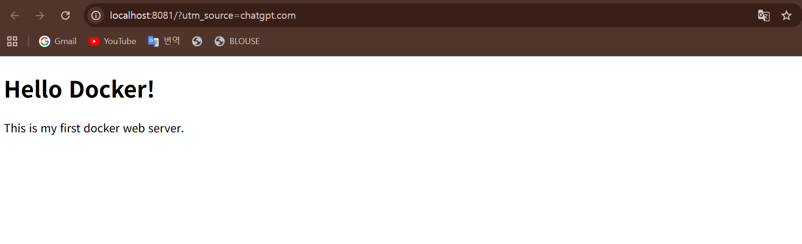
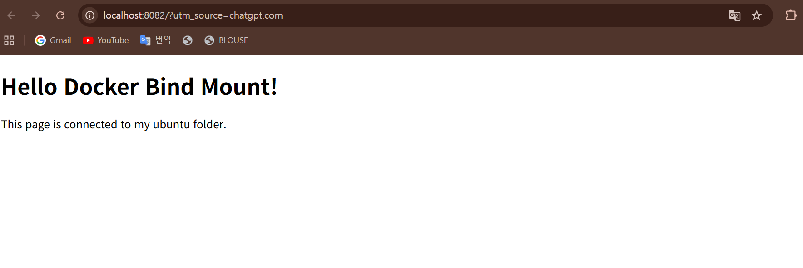
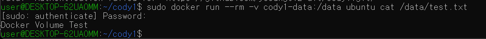

# Linux · Docker · Git 실습 프로젝트 (`cody1`)

> Windows의 WSL2 Ubuntu에서 Linux 파일 관리와 권한 설정을 연습하고, Docker로 Nginx 웹 서버를 구축한 뒤 Bind Mount·Volume·GitHub까지 학습한 기록입니다.
>
> **문서 작성 원칙:** 실제로 확보한 출력은 **실습 당시 기록**으로 표시하고, 설명을 위해 추가한 명령어는 **참고 명령어**로 구분합니다. 실행 시점에 따라 컨테이너 상태·ID·날짜·이미지 크기는 달라질 수 있습니다.

## 목차

1. [프로젝트 목표와 환경](#1-프로젝트-목표와-환경)
2. [프로젝트 폴더 구조](#2-프로젝트-폴더-구조)
3. [Linux 파일·디렉터리 관리](#3-linux-파일디렉터리-관리)
4. [Linux 권한과 chmod](#4-linux-권한과-chmod)
5. [Docker 설치·데몬·기본 실행 확인](#5-docker-설치데몬기본-실행-확인)
6. [Docker 이미지와 컨테이너 목록](#6-docker-이미지와-컨테이너-목록)
7. [Dockerfile로 Nginx 웹 서버 만들기](#7-dockerfile로-nginx-웹-서버-만들기)
8. [네트워크 네임스페이스와 포트 매핑](#8-네트워크-네임스페이스와-포트-매핑)
9. [Bind Mount 실습](#9-bind-mount-실습)
10. [Docker Volume 실습과 데이터 보호](#10-docker-volume-실습과-데이터-보호)
11. [Git과 GitHub 버전 관리](#11-git과-github-버전-관리)
12. [오류와 해결 과정](#12-오류와-해결-과정)
13. [평가 항목별 증빙 위치](#13-평가-항목별-증빙-위치)
14. [학습 결과 및 주의사항](#14-학습-결과-및-주의사항)

---

## 1. 프로젝트 목표와 환경

### 1.1 프로젝트 목적

명령어를 암기하는 데 그치지 않고 **명령어를 실행하면 어떤 변화가 발생하는지**, **Docker 컨테이너가 호스트와 어떻게 연결되는지**, **데이터를 어떻게 보존하는지**를 직접 확인하는 것이 목표입니다.

- Linux: 파일 생성·조회·복사·이름 변경·삭제, 접근 권한 변경
- Docker: 설치 확인, 데몬 통신, 이미지 조회, 컨테이너 실행
- Nginx: Dockerfile을 작성해 HTML 웹 페이지 제공
- 저장소 연결: Bind Mount로 개발 파일 공유, Volume으로 데이터 유지
- Git: 작업 이력을 커밋으로 관리하고 GitHub에 업로드
- 문제 해결: 실제 오류와 해결 과정 기록

### 1.2 실습 환경

| 항목 | 사용 환경 | 역할 |
|---|---|---|
| 호스트 운영체제 | Windows | Docker Desktop과 웹 브라우저 실행 |
| Linux 환경 | WSL2의 Ubuntu | Linux 명령어·Docker CLI·Git 실행 |
| 컨테이너 실행 환경 | Docker Desktop (WSL Integration) | Docker 데몬과 컨테이너 관리 |
| 웹 서버 | Nginx (`nginx:alpine`) | HTML 페이지 제공 |
| 편집기 | Visual Studio Code | HTML 및 프로젝트 문서 수정 |
| 버전 관리 | Git / GitHub | 변경 이력 및 원격 저장소 관리 |
| 원격 저장소 | https://github.com/yseung012-alt/cody1 | 프로젝트 기록 공유 |

**명령어를 입력하는 곳:** 아래의 `bash` 명령은 별도 언급이 없으면 **WSL Ubuntu 터미널**에서, `http://localhost:...` 주소는 **Windows 웹 브라우저**에서 사용합니다. `sudo`는 관리자 권한이 필요할 때 사용합니다.

---

## 2. 프로젝트 폴더 구조

실습 당시 문서에 기록한 프로젝트 구조입니다. 실제 GitHub에 올라간 파일 목록은 커밋 시점에 따라 다를 수 있습니다.

```text
cody1/
├── README.md
├── .gitignore
├── linux-evidence/
│   └── permission-test.txt
├── practice/
│   ├── hello.txt
│   ├── hello_backup.txt
│   └── perdem/
├── webserver/
│   ├── Dockerfile
│   └── index.html
├── bindmount/
│   └── index.html
└── screenshots/
    ├── nginx-webserver.png
    ├── bindmount-result.png
    └── docker-volume-result.png
```

| 경로 | 용도 |
|---|---|
| `README.md` | 실습 목적·명령어·결과·문제 해결 기록 |
| `.gitignore` | Git에 올리지 않을 임시 파일·환경 파일 지정 |
| `linux-evidence/` | 파일 생성·삭제 및 권한 변경 결과 확인 |
| `practice/` | Linux 기초 명령어 연습 |
| `webserver/` | Dockerfile과 이미지에 포함할 HTML 파일 |
| `bindmount/` | 호스트에서 수정할 HTML 파일 |
| `screenshots/` | 웹 서버·Bind Mount·Volume 결과 이미지 |

**왜 폴더를 나누는가?** 한 폴더에 모든 파일을 섞어 두면 실습 목적과 파일 역할을 구분하기 어렵습니다. 기능별로 나누면 수정할 파일과 증빙 자료를 빠르게 찾을 수 있습니다.

---

## 실습 결과를 읽는 방법

이 문서에서 **실제 출력**이라고 표시한 블록은 이전 실습 기록에 남아 있는 내용을 옮긴 것입니다. 명령어만 기록된 단계는 실제 출력이 확보된 단계와 구분했습니다. 출력의 시간·컨테이너 상태는 **실습 당시의 기록**이므로 지금 실행하면 달라질 수 있습니다.

## 3. Linux 파일·디렉터리 관리

### 3.1 기본 파일 조작

**목적:** Linux에서 디렉터리와 파일을 생성하고 내용을 저장·확인한 뒤, 복사하거나 이름을 바꾸는 방법을 익힙니다.

```bash
# Ubuntu 터미널: ~/cody1에서 시작
mkdir practice
cd practice
touch hello.txt
echo "hello Linux!" > hello.txt
cat hello.txt
cp hello.txt hello_copy.txt
mv hello_copy.txt hello_backup.txt
ls -l
```

| 명령어 | 이유와 기능 |
|---|---|
| `mkdir practice` | 실습용 디렉터리 생성. 이미 존재하면 오류가 날 수 있음 |
| `cd practice` | 작업 위치를 `practice`로 이동 |
| `touch hello.txt` | 비어 있는 파일 생성(기존 파일이면 수정 시간 갱신) |
| `echo "hello Linux!" > hello.txt` | 문자열을 파일에 기록. `>`는 기존 내용을 덮어씀 |
| `cat hello.txt` | 파일 내용을 터미널에 출력 |
| `cp 원본 사본` | 원본을 남기면서 복사 |
| `mv 이전이름 새이름` | 파일을 이동하거나 이름 변경 |
| `ls -l` | 파일 목록을 권한·소유자·크기 등과 함께 출력 |

`cat hello.txt`를 실행하면 앞서 기록한 `hello Linux!`를 확인할 수 있습니다. 다만 이 단계의 전체 터미널 출력은 원본 문서에 보존되어 있지 않아, 위 내용은 **실습 명령어 기록**입니다.

### 3.2 생성·이름 변경·삭제: 실제 출력 기록

이 실습은 프로젝트 루트인 `~/cody1`에서 진행했습니다.

**① 디렉터리 생성**

```bash
mkdir linux-evidence
ls -ld linux-evidence
```

실습 당시 출력:

```text
drwxr-xr-x 2 user user 4096 Nov 19 14:17 linux-evidence
```

`-d`를 붙이면 디렉터리 안의 파일 목록이 아니라 **디렉터리 자체의 정보**를 확인합니다. 출력 맨 앞의 `d`는 디렉터리라는 뜻입니다.

**② 파일 생성**

```bash
touch linux-evidence/test.txt
ls -l linux-evidence/
```

실습 당시 출력:

```text
total 0
-rw-r--r-- 1 user user 0 Nov 19 14:18 test.txt
```

파일 크기가 `0`이므로 내용이 없는 빈 파일입니다. 맨 앞의 `-`는 일반 파일을 뜻합니다.

**③ 파일 이름 변경**

```bash
mv linux-evidence/test.txt linux-evidence/renamed.txt
ls -l linux-evidence/
```

실습 당시 출력:

```text
total 0
-rw-r--r-- 1 user user 0 Nov 19 14:18 renamed.txt
```

같은 디렉터리 안에서 `mv`를 사용하면 파일 이름이 `test.txt`에서 `renamed.txt`로 바뀝니다.

**④ 파일 삭제**

```bash
rm linux-evidence/renamed.txt
ls -l linux-evidence/
```

실습 당시 출력:

```text
total 0
```

목록에서 파일이 사라진 것을 확인했습니다. `rm`은 휴지통으로 보내는 명령이 아니므로 삭제할 경로를 주의해야 합니다.

**정리:** 생성(`mkdir`, `touch`) → 확인(`ls`) → 변경(`mv`) → 삭제(`rm`)의 결과를 출력으로 확인했습니다.

---

### 앞선 Linux 파일 실습 결과의 상세 해석

`drwxr-xr-x 2 user user 4096 Nov 19 14:17 linux-evidence`에서 `d`는 디렉터리, `rwxr-xr-x`는 소유자에게 읽기·쓰기·접근 권한이 있고 그룹과 기타 사용자에게 읽기·접근 권한이 있다는 뜻입니다. `user user`는 각각 소유자와 그룹입니다. `4096`은 표시된 디렉터리 항목의 크기(바이트)이고, 뒤의 날짜와 시간은 출력에 표시된 수정 시각입니다.

`-rw-r--r-- 1 user user 0 Nov 19 14:18 test.txt`에서는 앞의 `-`가 일반 파일임을 뜻합니다. 크기가 `0`이므로 빈 파일입니다. `mv` 후 같은 정보에 파일명만 `renamed.txt`로 나타난 것은 **이름 변경이 반영되었다는 증거**입니다. `rm` 후 `ls -l`이 `total 0`만 표시한 것은 해당 목록에 파일 항목이 없다는 뜻입니다. `total 0` 자체가 삭제 명령의 성공 메시지는 아니고, **삭제 후 다시 조회한 목록**을 해석한 결과입니다.

## 4. Linux 권한과 chmod

### 4.1 파일 권한이 필요한 이유

Linux는 파일을 누가 읽고, 수정하고, 실행할 수 있는지 구분합니다. 여러 사용자가 같은 시스템을 이용할 때 원하지 않는 수정이나 실행을 제한하기 위한 기능입니다.

권한 문자열은 **소유자(User) / 그룹(Group) / 기타 사용자(Others)** 순서로 해석합니다.

| 기호 | 뜻 | 숫자 |
|---|---|---:|
| `r` | 읽기(Read) | 4 |
| `w` | 쓰기(Write) | 2 |
| `x` | 실행(Execute) | 1 |
| `-` | 해당 권한 없음 | 0 |

- **`755`**: 소유자 `7 = 4+2+1` (`rwx`), 그룹 `5 = 4+1` (`r-x`), 기타 `5 = 4+1` (`r-x`) → `rwxr-xr-x`
- **`644`**: 소유자 `6 = 4+2` (`rw-`), 그룹 `4` (`r--`), 기타 `4` (`r--`) → `rw-r--r--`
- **`700`**: 소유자만 `rwx`, 그룹·기타 사용자는 권한 없음 → `rwx------`

일반 파일에서 `x`는 실행 권한을 뜻하고, 디렉터리에서는 디렉터리 내부 경로에 접근·탐색할 수 있는 권한과 관련됩니다. 따라서 **디렉터리의 `x`는 파일의 `x`와 사용 의미가 다릅니다.**

### 4.2 chmod 644 → 755 → 644 실제 확인

**목적:** 숫자로 권한을 변경하고 `ls -l` 출력이 실제로 달라지는지 확인합니다.

**① 변경 전**

```bash
ls -l linux-evidence/permission-test.txt
```

```text
-rw-r--r-- 1 user user 0 Nov 19 14:39 linux-evidence/permission-test.txt
```

**② 755로 변경**

```bash
chmod 755 linux-evidence/permission-test.txt
ls -l linux-evidence/permission-test.txt
```

```text
-rwxr-xr-x 1 user user 0 Nov 19 14:39 linux-evidence/permission-test.txt
```

소유자·그룹·기타 사용자에 실행 권한(`x`)이 추가됐습니다. 단, 빈 텍스트 파일에 실행 권한을 준다고 실행 가능한 프로그램이 되는 것은 아닙니다.

**③ 644로 되돌리기**

```bash
chmod 644 linux-evidence/permission-test.txt
ls -l linux-evidence/permission-test.txt
```

```text
-rw-r--r-- 1 user user 0 Nov 19 14:39 linux-evidence/permission-test.txt
```

실행 권한이 제거된 것을 확인했습니다.

### 4.3 디렉터리 700 권한

```bash
# practice 디렉터리에서 진행한 실습
mkdir perdem
chmod 700 perdem
ls -ld perdem
```

`700`은 소유자만 디렉터리를 읽고·변경하고·탐색하도록 설정하는 값입니다. **이 실습의 `ls -ld` 실제 출력은 제공된 원본에 없으므로 새로 만들어 넣지 않았습니다.**

---

### 권한 변경 출력의 상세 해석

권한 변경 전 `-rw-r--r--`는 소유자가 읽기·쓰기, 그룹과 기타 사용자가 읽기만 가능한 상태입니다. `chmod 755` 후 `-rwxr-xr-x`로 바뀌었다는 것은 **소유자뿐 아니라 그룹과 기타 사용자에게도 실행 권한이 추가되었다**는 뜻입니다. 다시 `chmod 644` 후 `-rw-r--r--`로 돌아온 것은 실행 권한이 제거되었음을 보여줍니다.

세 출력 모두 파일 크기가 `0`으로 나타납니다. 즉, 이 실습은 파일의 **내용 변경이 아니라 접근 권한 변경**을 확인한 것입니다. `chmod 700 perdem`은 디렉터리를 소유자만 접근하도록 제한하기 위한 명령입니다. 단, `perdem`의 실제 `ls -ld` 출력은 제공된 원본에 없으므로 **실행 명령어와 권한의 의미**를 기록한 것이며 출력 문자열을 임의로 추가하지 않았습니다.

## 5. Docker 설치·데몬·기본 실행 확인

### 5.1 Docker가 하는 일

Docker는 애플리케이션과 실행에 필요한 환경을 **이미지(Image)**로 준비하고, 그 이미지를 실행 가능한 **컨테이너(Container)**로 만드는 도구입니다.

- **Docker CLI(클라이언트):** 사용자가 `docker ...` 명령을 입력하는 인터페이스
- **Docker 데몬(서버):** 이미지·컨테이너를 실제로 관리하는 서비스
- **Docker Desktop:** Windows에서 Docker 엔진을 관리하며 WSL Ubuntu와 통합 가능

### 5.2 설치 버전 확인

```bash
sudo docker --version
```

실습 당시 출력:

```text
Docker version 29.9.2, build a82e528
```

이 명령은 Docker **클라이언트 프로그램 버전**을 확인합니다. 버전 출력만으로 데몬까지 정상 작동한다고 단정할 수는 없습니다.

### 5.3 데몬 연결 확인

```bash
sudo docker info
```

실습 당시 출력 중 주요 부분:

```text
Server:
 Containers: 5
  Running: 2
  Paused: 0
  Stopped: 3
 Images: 7
 Server Version: 29.9.2
```

`Server:` 아래에 컨테이너·이미지 수와 서버 버전이 출력되었으므로 **이 명령을 실행한 시점에는 Docker 클라이언트가 데몬과 통신할 수 있었습니다.** 숫자는 현재 상태와 다를 수 있습니다.

### 5.4 hello-world 컨테이너

**목적:** 이미지 확보 → 컨테이너 생성 → 실행 → 출력의 가장 간단한 흐름을 확인합니다.

```bash
sudo docker run hello-world
```

실습 당시 기록된 출력:

```text
Hello from Docker!
This message shows that your installation appears to be working correctly.
```

- `docker run`: 이미지로 컨테이너를 만들고 실행
- `hello-world`: 실행할 이미지 이름
- 결과 메시지: Docker의 기본 컨테이너 실행 경로가 정상 동작했음을 뜻함

컨테이너를 실행 후 자동 삭제하려면 다음 옵션을 사용할 수 있습니다.

```bash
sudo docker run --rm hello-world
```

`--rm`은 **컨테이너가 종료된 후 해당 컨테이너를 삭제**합니다. 이미지를 삭제하는 옵션은 아닙니다. 원본 기록에는 `hello-world` 출력과 `--rm` 실행 명령이 있으나, 두 실행 각각의 전체 원본 로그는 분리되어 있지 않습니다.

### 5.5 Ubuntu 컨테이너 안으로 들어가기

```bash
sudo docker run -it --name ubuntu-test ubuntu bash
```

| 부분 | 의미 |
|---|---|
| `run` | 이미지로 컨테이너 생성 및 실행 |
| `-i` | 표준 입력 유지 |
| `-t` | 터미널 할당 |
| `--name ubuntu-test` | 컨테이너 이름 지정 |
| `ubuntu` | 실행할 이미지 |
| `bash` | 컨테이너에서 실행할 셸 |

컨테이너 내부에서:

```bash
cat /etc/os-release
exit
```

`/etc/os-release`는 컨테이너 내부 Linux 배포판 정보를 보여줍니다. `exit`로 셸을 종료하면 해당 셸이 주 프로세스인 컨테이너도 종료됩니다. **정확한 `/etc/os-release` 전체 출력은 첨부 문서에 없으므로 생략했습니다.**

---

### Docker 버전·데몬·hello-world 출력의 상세 해석

- `Docker version 29.9.2, build a82e528`: 당시 Ubuntu에서 호출한 Docker 명령줄 도구의 버전이 **29.9.2**였다는 뜻입니다. `build` 뒤 문자열은 해당 빌드를 식별하는 값입니다. 이 한 줄만으로는 Docker 서버(데몬)가 작동하는지 확인할 수 없습니다.
- `docker info`의 `Server:`: 클라이언트가 Docker 서버의 정보를 받아왔음을 뜻합니다. `Containers: 5`는 조회 당시 컨테이너가 총 5개였고, `Running: 2`, `Stopped: 3`, `Paused: 0`은 그 상태별 개수입니다. `Images: 7`은 서버가 보고한 이미지 수입니다. 이 값들은 시간이 지나면 바뀝니다.
- `Server Version: 29.9.2`: 서버가 보고한 버전입니다. 앞의 클라이언트 버전과 구분해서 읽어야 합니다.
- `Hello from Docker!`: 테스트 이미지로 만든 컨테이너가 정상 실행되어 메시지를 출력했다는 직접적인 결과입니다. `This message shows that your installation appears to be working correctly.`는 Docker가 기본적인 컨테이너 실행 경로를 성공적으로 통과했다는 안내입니다. **모든 Docker 기능이 문제없다는 보증은 아닙니다.**
- `--rm`: 실행을 마친 테스트 컨테이너를 자동으로 삭제합니다. 따라서 이 옵션으로 실행한 컨테이너가 나중에 `docker ps -a` 목록에 없는 것은 정상입니다.

**주의:** 위 값은 제공된 기록에 있던 실제 결과입니다. 현재 Docker 상태를 새로 측정한 결과는 아닙니다.

## 6. Docker 이미지와 컨테이너 목록

### 6.1 전체 컨테이너 조회

```bash
sudo docker ps -a
```

- `docker ps`: 실행 중인 컨테이너 조회
- `-a`: 종료된 컨테이너까지 **모두** 조회

실습 당시 출력:

```text
CONTAINER ID   IMAGE          STATUS                         PORTS                  NAMES
8bb0450f5e51   nginx:alpine   Exited (255) 20 minutes ago    0.0.0.0:8082->80/tcp   bindmount-test
9174e0130be2   cody1-web      Exited (255) 20 minutes ago    0.0.0.0:8081->80/tcp   cody1-web-container
67d3ad75d2d2   ubuntu         Exited (0) 2 days ago                                 ubuntu-test
33f58c03f9fb   hello-world    Exited (0) 2 days ago                                 stoic_buck
```

**출력 읽는 방법:** `IMAGE`는 컨테이너를 생성한 이미지, `STATUS`는 상태, `PORTS`는 포트 연결, `NAMES`는 이름입니다. 여기서는 웹 서버 컨테이너가 `Exited (255)` 상태입니다. 이는 **목록 조회 시점에 종료되어 있었다는 사실**을 나타내며, 과거에 브라우저로 웹 페이지를 확인했다는 기록과 모순되지 않습니다. `255`의 정확한 종료 원인은 이 목록만으로 판단할 수 없습니다.

### 6.2 이미지 목록 조회

```bash
sudo docker images
```

원본 실습 문서에 정리된 이미지 정보:

| 이미지 | 이미지 ID | 기록된 디스크 사용량 |
|---|---|---:|
| `cody1-web:latest` | `076d22702503` | 93.7 MB |
| `hello-world:latest` | `c567b231f656` | 25.9 kB |
| `my-web:latest` | `7ec3599729ab` | 241 MB |
| `nginx:alpine` | `fed7e14be83c` | 94.5 MB |
| `nginx:latest` | `165ddde8751e` | 243 MB |
| `ubuntu:latest` | `6a06111c3b0a` | 163 MB |

이 표는 **원본 문서에서 옮긴 정리표**이며 `docker images`의 터미널 출력을 그대로 복제한 형식은 아닙니다. `docker images`는 일반적으로 이미지 이름·태그·ID·생성 시점·크기 등을 표시하며, Docker 버전에 따라 표시 형식이 달라질 수 있습니다.

### 6.3 이미지와 컨테이너의 차이

| 구분 | 이미지(Image) | 컨테이너(Container) |
|---|---|---|
| 의미 | 실행 환경을 담은 읽기 전용 기반 템플릿 | 이미지를 바탕으로 생성한 실행 인스턴스 |
| 비유 | 게임 설치 파일·기본 패키지 | 실제 실행 중인 게임 세션 |
| 예시 | `cody1-web` | `cody1-web-container` |
| 생성 방법 | `docker build` 또는 `docker pull` | `docker run` |
| 삭제 영향 | 이미지 삭제는 해당 이미지의 관리 상태에 영향 | 컨테이너 삭제만으로 이미지는 보통 유지 |

실습에서는 `Dockerfile`로 `cody1-web` 이미지를 빌드하고 그 이미지로 `cody1-web-container`를 실행했습니다. **하나의 이미지로 여러 컨테이너를 만들 수 있습니다.**

---

### 컨테이너·이미지 목록 출력의 상세 해석

`docker ps -a`의 각 열은 다음처럼 읽습니다.

| 열 | 결과에서 확인하는 의미 |
|---|---|
| `CONTAINER ID` | 컨테이너 식별자. 예: `8bb0450f5e51` |
| `IMAGE` | 컨테이너를 만들 때 사용한 이미지. 예: `nginx:alpine` |
| `STATUS` | 실행 중인지 종료되었는지. `Exited (0)`은 프로세스가 정상 종료한 경우이고, `Exited (255)`는 비정상 종료 상태 코드가 기록된 경우입니다. **255만으로 정확한 원인은 알 수 없습니다.** |
| `PORTS` | 호스트와 컨테이너의 연결 포트. `0.0.0.0:8082->80/tcp`는 호스트의 8082 포트를 컨테이너의 TCP 80 포트로 게시한 설정입니다. |
| `NAMES` | 사람이 지정하거나 Docker가 자동으로 붙인 컨테이너 이름 |

실제 목록의 `bindmount-test`와 `cody1-web-container`는 **조회 당시** `Exited (255)`였습니다. 따라서 이 출력만으로는 그 시점에 웹 서버가 실행 중이었다고 주장할 수 없습니다. 반면 별도로 기록된 브라우저 접속 결과는 **접속을 확인했던 당시** 웹 페이지가 열렸다는 증거입니다. 서로 다른 시점의 기록으로 해석해야 합니다.

`ubuntu-test`와 `stoic_buck`의 `Exited (0)`은 종료 코드 0으로 종료되었다는 뜻입니다. `stoic_buck`은 Docker가 자동으로 생성한 이름이며, `hello-world` 이미지를 사용했습니다.

`docker images` 목록은 **실행 중인 컨테이너가 아니라 저장된 이미지**를 보여줍니다. 예를 들어 `cody1-web:latest`는 직접 빌드한 이미지이고, `nginx:alpine`은 기반 이미지입니다. `IMAGE ID`는 이미지 식별자, `DISK USAGE`는 기록 당시 표시된 디스크 사용량입니다. 이미지가 존재한다고 해서 해당 이미지의 컨테이너가 실행 중이라는 뜻은 아닙니다.

또한 `docker info`에는 이미지 7개라고 기록되었지만, 제공된 `docker images` 정리 표에는 6개 행만 남아 있습니다. **조회 시점 또는 표 정리 범위가 다를 수 있으므로**, 두 수치를 억지로 일치시키지 않았습니다.

## 7. Dockerfile로 Nginx 웹 서버 만들기

### 7.1 Dockerfile이 필요한 이유

매번 컨테이너 안에서 웹 서버와 파일을 수동으로 설정하면 재현하기 어렵습니다. Dockerfile은 **어떤 이미지를 바탕으로 어떤 파일을 포함할지**를 코드로 기록합니다.

파일: `webserver/Dockerfile`

```dockerfile
FROM nginx:alpine
COPY index.html /usr/share/nginx/html/index.html
```

- `FROM nginx:alpine`: Nginx가 설치된 Alpine Linux 기반 이미지를 시작점으로 사용
- `COPY index.html ...`: 빌드 시점의 HTML 파일을 이미지 내부 Nginx 기본 웹 루트에 복사
- `/usr/share/nginx/html/index.html`: Nginx가 기본 설정에서 제공하는 HTML 파일 위치

`webserver/index.html`은 실제로 작성한 웹 페이지 파일입니다. **HTML 전체 소스는 제공된 문서에 포함되어 있지 않아 임의로 작성하지 않았습니다.**

### 7.2 이미지 빌드

```bash
cd ~/cody1/webserver
sudo docker build -t cody1-web .
```

- `build`: Dockerfile로 이미지 생성
- `-t cody1-web`: 이미지 이름(태그) 지정
- 마지막 `.`: **현재 디렉터리를 빌드 컨텍스트로 사용**. Dockerfile의 `COPY index.html`이 이 디렉터리의 파일을 참조함

실습 결과: `cody1-web` 이미지가 생성되었으며, 이후 컨테이너 실행에 사용했습니다. **빌드 단계별 터미널 원본 로그는 제공된 문서에 없어 재구성하지 않았습니다.**

### 7.3 웹 서버 컨테이너 실행

```bash
sudo docker run -d --name cody1-web-container -p 8081:80 cody1-web
```

| 부분 | 의미 |
|---|---|
| `-d` | 백그라운드 실행 |
| `--name cody1-web-container` | 컨테이너 이름 지정 |
| `-p 8081:80` | 호스트의 8081번 포트를 컨테이너의 80번 포트에 게시 |
| `cody1-web` | 앞에서 빌드한 이미지 |

### 7.4 브라우저 확인

Windows 웹 브라우저에서 다음 주소에 접속했습니다.

```text
http://localhost:8081
```

**실습 당시 결과:** 작성한 HTML 웹 페이지가 표시되는 것을 확인했습니다.



스크린샷이 GitHub에서 보이려면 위 상대 경로에 해당 이미지 파일이 실제로 업로드되어 있어야 합니다.

### 7.5 왜 HTML 수정 후 재빌드가 필요한가?

`COPY`는 **이미지를 빌드하는 순간** HTML 파일을 이미지에 포함합니다. 따라서 호스트의 `webserver/index.html`만 바꾸어도 이미 생성된 이미지와 컨테이너의 파일이 자동으로 바뀌지는 않습니다. 변경된 파일을 이미지에 반영하려면 일반적으로 **이미지를 다시 빌드하고 새 컨테이너를 생성**해야 합니다. 다음 Bind Mount 실습은 이 불편함을 해결하는 방법입니다.

---

### Nginx 웹 서버 실습 결과 해석

이 단계에서 확인하려던 결과는 **사용자가 작성한 `index.html`이 Nginx를 통해 브라우저에 표시되는지**입니다. Dockerfile의 `COPY`는 빌드 시점의 HTML을 이미지 안에 넣고, `docker run`은 그 이미지를 바탕으로 웹 서버 컨테이너를 시작합니다.

기록된 `http://localhost:8081` 접속 성공은 **호스트 8081번 포트에서 Nginx 페이지에 접근할 수 있었다**는 뜻입니다. `localhost`는 접속한 컴퓨터 자신을 가리키고, `8081`은 호스트 측 포트입니다. 실제 화면은 `screenshots/nginx-webserver.png`에 연결되어 있습니다. 스크린샷 파일이 GitHub에 존재해야 README에서 이미지가 표시됩니다.

다만 원본에는 `docker build` 전체 출력이나 `docker run`이 반환한 컨테이너 ID가 보존되어 있지 않습니다. 따라서 그 출력까지 만들어 넣지는 않았습니다.

## 8. 네트워크 네임스페이스와 포트 매핑

### 8.1 네트워크 네임스페이스란?

Docker의 일반적인 브리지 네트워크에서 컨테이너는 별도 **네트워크 네임스페이스(network namespace)**를 사용합니다. 네트워크 네임스페이스는 네트워크 인터페이스·IP 주소·라우팅·포트 공간 등을 논리적으로 분리하는 Linux 기능입니다.

즉, 컨테이너 안에서 Nginx가 80번 포트로 실행된다고 해서 Windows 브라우저가 자동으로 그 포트에 접근할 수 있는 것은 아닙니다.

### 8.2 `-p 8081:80`의 의미

```text
Windows 브라우저
    |
    | http://localhost:8081
    v
호스트에 게시된 8081번 포트
    |
    | Docker 포트 전달
    v
Nginx 컨테이너의 80번 포트
    |
    v
index.html 응답
```

```bash
-p 8081:80
```

- 왼쪽 `8081`: **호스트**에서 접근할 포트
- 오른쪽 `80`: **컨테이너 내부**에서 Nginx가 사용하는 포트

호스트와 컨테이너의 포트 번호가 같을 필요는 없습니다. 같은 호스트에서 웹 서버 컨테이너를 여러 개 실행할 때는 서로 다른 **호스트 포트**를 게시해야 충돌을 피할 수 있습니다.

### 8.3 포트 8080 충돌과 8081 변경

처음에는 호스트의 8080번 포트를 사용하려 했지만 포트 연결에 실패했습니다. 이후 **호스트 포트를 8081로 변경**해 웹 페이지를 확인했습니다.

**실제로 적용한 해결 명령어:**

```bash
sudo docker run -d --name cody1-web-container -p 8081:80 cody1-web
```

원본에는 최초 충돌 당시 **정확한 오류 문구나 포트 점유 프로세스 출력이 남아 있지 않습니다.** 따라서 어느 프로세스가 8080번 포트를 점유했는지는 단정하지 않습니다. 구체적인 점검 방법은 12.2절에 정리했습니다.

---

### 포트 매핑과 충돌 결과 해석

`-p 8081:80`은 **호스트의 8081번 포트로 들어온 연결을 컨테이너의 80번 포트로 전달하도록 게시**하는 설정입니다. 포트가 두 개라고 해서 Nginx가 호스트와 컨테이너에서 각각 두 번 실행되는 것은 아닙니다. Nginx는 컨테이너 내부 80번 포트에서 요청을 받습니다.

실습 기록에는 처음 `8080`을 사용하려다 연결 실패가 발생했고, `8081`로 변경한 뒤 브라우저 접속에 성공했다고 남아 있습니다. 이 결과로 확인할 수 있는 것은 **포트를 변경해 웹 서버에 접근할 수 있게 되었다는 사실**입니다. 당시 8080번 포트를 어느 프로세스가 점유했는지 확인한 실제 `ss` 출력은 없으므로 특정 프로그램이 원인이었다고 단정하지 않았습니다.

## 9. Bind Mount 실습

### 9.1 Bind Mount를 사용하는 이유

Bind Mount는 **호스트의 특정 파일 또는 디렉터리를 컨테이너 내부 경로에 직접 연결**합니다. 개발 중 HTML 파일을 자주 바꿀 때 이미지를 매번 다시 빌드하지 않아도 된다는 장점이 있습니다.

### 9.2 실제 실행 명령어

```bash
sudo docker run -d \
  --name bindmount-test \
  -p 8082:80 \
  -v /home/user/cody1/bindmount:/usr/share/nginx/html:ro \
  nginx:alpine
```

| 설정 | 설명 |
|---|---|
| `--name bindmount-test` | 컨테이너 이름 |
| `-p 8082:80` | 호스트 8082 → 컨테이너 80 |
| `/home/user/cody1/bindmount` | WSL Ubuntu에 실제 파일이 저장된 **호스트 경로** |
| `/usr/share/nginx/html` | 컨테이너 내부 Nginx 웹 루트 |
| `:ro` | 컨테이너에서 연결된 경로를 **읽기 전용**으로 사용 |
| `nginx:alpine` | Nginx 이미지 사용 |

`-v`의 디렉터리 마운트 형식은 `호스트경로:컨테이너경로:옵션`입니다. `:ro`는 컨테이너가 파일을 수정하지 못하도록 제한하지만, **호스트에서 파일을 수정하는 것은 막지 않습니다.**

### 9.3 VS Code에서 수정한 결과 확인

1. VS Code에서 `bindmount/index.html`을 수정하고 저장했습니다.
2. Windows 브라우저에서 `http://localhost:8082`를 새로고침했습니다.
3. 변경한 HTML 내용이 표시되는 것을 확인했습니다.



**실습 결과:** 이미지 재빌드 없이 호스트 파일 수정이 컨테이너의 웹 페이지에 반영되었습니다.

### 9.4 절대 경로가 중요한 이유

처음 실행할 때 마운트 경로를 잘못 지정하여 오류가 발생했습니다. 이후 컨테이너 내부 경로를 `/usr/share/nginx/html`처럼 **`/`로 시작하는 절대 경로**로 지정해 해결했습니다. 호스트 경로 역시 `/home/user/cody1/bindmount`로 명시했습니다.

절대 경로는 현재 작업 디렉터리와 관계없이 위치를 분명히 지정합니다. `-v` 옵션은 경로 형식이 중요하므로 **호스트 경로와 컨테이너 경로를 구분**해야 합니다.

---

### Bind Mount 화면 결과 해석

이 실습의 핵심 결과는 VS Code에서 `bindmount/index.html`을 수정한 뒤, `http://localhost:8082`를 새로고침했을 때 **수정된 HTML이 표시되었다**는 점입니다. 이는 Nginx가 이미지에 복사된 고정 HTML 대신 호스트 디렉터리에 연결된 파일을 읽었음을 보여줍니다.

`-v /home/user/cody1/bindmount:/usr/share/nginx/html:ro`는 콜론을 기준으로 세 부분입니다. 첫 부분은 **Ubuntu 호스트 파일 위치**, 둘째는 **컨테이너 안에서 Nginx가 읽는 위치**, 마지막 `ro`는 **컨테이너에서 읽기 전용**이라는 뜻입니다. `ro`라고 해서 호스트의 VS Code에서도 수정할 수 없다는 의미는 아닙니다. 호스트에서 수정한 내용을 컨테이너가 읽는 구조이므로 이번 결과와 모순되지 않습니다.

웹 화면은 `screenshots/bindmount-result.png`에 연결되어 있습니다. 최초 경로 오류의 전체 오류 메시지는 제공된 자료에 없고, 절대 경로로 고친 뒤 성공했다는 과정만 확인됩니다.

## 10. Docker Volume 실습과 데이터 보호

### 10.1 Volume을 사용하는 이유

컨테이너는 삭제하거나 다시 만들 수 있는 실행 단위입니다. 컨테이너 내부에만 데이터를 두면 컨테이너 삭제 시 데이터도 함께 사라질 수 있습니다. Docker Volume은 **Docker가 별도로 관리하는 저장 공간**으로, 컨테이너와 데이터의 수명 주기를 분리합니다.

### 10.2 Volume 생성

```bash
sudo docker volume create cody1-data
sudo docker volume ls
```

- `volume create`: `cody1-data`라는 이름의 Volume 생성
- `volume ls`: Volume 목록 조회

### 10.3 Volume에 파일 저장

```bash
sudo docker run -it --name volume-test -v cody1-data:/data ubuntu bash
```

`-v cody1-data:/data`는 Docker가 관리하는 `cody1-data` Volume을 컨테이너 내부 `/data`에 연결합니다.

컨테이너 내부에서 실행:

```bash
echo "Docker Volume Test" > /data/test.txt
cat /data/test.txt
exit
```

`echo`로 문자열을 파일에 쓰고, `cat`으로 확인한 다음 종료했습니다.

### 10.4 컨테이너 삭제 후 파일 유지 확인

```bash
sudo docker rm volume-test
sudo docker run --rm -v cody1-data:/data ubuntu cat /data/test.txt
```

실습 당시 출력:

```text
Docker Volume Test
```

**이 결과가 중요한 이유:** 기존 `volume-test` 컨테이너를 삭제한 후에도 **새 컨테이너에서 같은 Volume의 파일을 읽을 수 있었습니다.** 따라서 파일이 삭제한 컨테이너에만 저장된 것이 아니라 Volume에 유지되고 있음을 확인했습니다.



### 10.5 Bind Mount와 Volume 비교

| 구분 | Bind Mount | Docker Volume |
|---|---|---|
| 저장 위치 | 사용자가 지정한 호스트 파일·디렉터리 | Docker가 관리하는 저장 공간 |
| 대표 목적 | 개발 파일 공유, 소스 수정 반영 | 컨테이너와 분리된 데이터 유지 |
| 호스트 파일 직접 수정 | 쉬움 | 일반적으로 Docker를 통해 관리 |
| 이번 실습 | HTML 수정 후 브라우저 새로고침 | 컨테이너 삭제 후 `test.txt` 유지 |
| 주의할 점 | 호스트 경로와 접근 권한 확인 | Volume 삭제·장치 장애에 대비한 백업 필요 |

### 10.6 Volume 데이터 보호 및 백업

Volume이 컨테이너 삭제 후에도 남는다고 해서 **영구적으로 안전한 것은 아닙니다.** 사용자가 Volume을 삭제하거나 저장 장치에 장애가 발생하면 데이터가 손실될 수 있습니다.

중요한 데이터를 관리할 때는 다음 원칙이 필요합니다.

1. Volume 내용을 별도 백업 파일로 저장합니다.
2. 백업 파일을 원본과 다른 저장 위치에도 보관합니다.
3. 백업 파일이 실제로 복원되는지 정기적으로 검증합니다.
4. 데이터 중요도에 맞게 백업 주기·보관 기간을 정합니다.

**참고 예시 — 백업 명령어(이번 실습에서 실행한 증거는 없음):**

```bash
# Ubuntu 터미널에서 실행하는 예시. 현재 디렉터리에 백업 파일 생성
sudo docker run --rm \
  -v cody1-data:/data:ro \
  -v "$PWD":/backup \
  ubuntu tar -czf /backup/cody1-data-backup.tar.gz -C /data .
```

이 명령은 Volume을 `/data`에 읽기 전용으로 연결하고, 현재 디렉터리를 `/backup`에 연결한 뒤 압축 파일을 만듭니다. **실습에서 실제 수행한 것은 데이터 유지 확인까지이며, 백업·복원 테스트는 수행하지 않았습니다.**

---

### Volume 출력 결과의 상세 해석

이 실습에서 가장 중요한 출력은 다음 한 줄입니다.

```text
Docker Volume Test
```

이 한 줄을 **언제 확인했는지**가 중요합니다. 먼저 `volume-test` 컨테이너 안에서 `/data/test.txt`에 문자열을 저장했고, 컨테이너를 삭제한 다음 **새 컨테이너**에 같은 `cody1-data` 볼륨을 연결하여 `cat /data/test.txt`로 내용을 읽었습니다. 그 결과 같은 문자열이 다시 출력되었습니다.

따라서 증명된 것은 **기존 컨테이너를 삭제해도 볼륨을 삭제하지 않으면 저장한 파일이 남아 있었다**는 사실입니다. 이것은 컨테이너 자체의 파일 시스템과 볼륨 저장소가 구분된다는 실습 증거입니다. 반면 이 출력만으로 백업·복구까지 성공했다고 주장할 수는 없습니다. 백업·복구는 별도로 실행한 기록이 없는 **추가 권장 절차**입니다.

## 11. Git과 GitHub 버전 관리

### 11.1 Git을 사용하는 이유

Git은 파일의 변경 이력을 **커밋(commit)** 단위로 기록합니다. 코드나 문서를 수정하다 문제가 생기면 과거 버전과 비교할 수 있고, GitHub에 올리면 원격 저장소에서도 이력을 확인할 수 있습니다.

- **작업 디렉터리:** 실제로 수정하는 파일
- **스테이징 영역:** 다음 커밋에 포함할 변경을 선택하는 곳
- **커밋:** 선택한 변경 사항을 하나의 기록으로 저장
- **원격 저장소:** GitHub처럼 로컬 외부에 있는 저장소

### 11.2 저장소 초기화

```bash
cd ~/cody1
git init
git branch -m main
```

- `git init`: 현재 폴더를 Git 저장소로 설정
- `git branch -m main`: 현재 브랜치 이름을 `main`으로 변경

### 11.3 파일 추가 및 커밋

```bash
git add .
git commit -m "Initial commit: Linux and Docker practice"
```

- `git add .`: 현재 디렉터리 이하 변경 사항을 스테이징(단, `.gitignore` 규칙 적용)
- `git commit -m "..."`: 스테이징된 변경을 메시지와 함께 기록

**주의:** `git add .` 전에 `git status`로 비밀번호·토큰·환경 파일 등 민감한 정보가 포함되지 않았는지 확인해야 합니다. `.gitignore`는 **이미 추적 중인 파일을 자동으로 추적 해제하지는 않습니다.**

### 11.4 GitHub 원격 저장소 연결

```bash
git remote add origin https://github.com/yseung012-alt/cody1.git
git remote -v
```

`origin`은 원격 저장소에 붙인 이름입니다. `git remote -v`는 연결된 주소를 확인하는 명령입니다. 이미 `origin`이 있다면 `remote add`를 다시 실행할 필요는 없습니다.

### 11.5 GitHub Push 성공 기록

```bash
git push -u origin main
```

- `push`: 로컬 커밋을 원격 저장소로 전송
- `-u`: 로컬 브랜치와 원격 브랜치의 추적 관계 설정
- `origin main`: 업로드 대상 원격 저장소와 브랜치

과거 성공 로그:

```text
To https://github.com/yseung012-alt/cody1.git
   8f2911a..b3f2fb4  main -> main
```

`main -> main`은 로컬 `main`의 커밋이 원격 `main`으로 반영됐음을 뜻합니다.

- [GitHub 프로젝트 저장소](https://github.com/yseung012-alt/cody1)
- [당시 Push 성공 커밋 `b3f2fb4`](https://github.com/yseung012-alt/cody1/commit/b3f2fb4)

**증빙 범위:** 위 로그는 **해당 과거 커밋의 Push 성공**을 나타냅니다. 이후 수정한 README까지 모두 업로드됐다는 증거로 해석해서는 안 됩니다.

---

### GitHub Push 출력 결과의 상세 해석

기록된 Push 성공 출력:

```text
To https://github.com/yseung012-alt/cody1.git
   8f2911a..b3f2fb4  main -> main
```

`To ...`는 Push 대상 원격 저장소를 가리킵니다. `8f2911a..b3f2fb4`는 원격 브랜치가 이전 커밋에서 새 커밋으로 갱신된 범위를 나타내며, `main -> main`은 **로컬 `main`의 내용이 원격 `main`에 반영되었다**는 뜻입니다.

따라서 이 로그는 **해당 시점의 Push 성공 증거**입니다. 이후 README 수정본까지 업로드되었다는 증거로 해석하면 안 됩니다. GitHub의 커밋 링크 `https://github.com/yseung012-alt/cody1/commit/b3f2fb4`로 당시 커밋을 확인할 수 있습니다.

## 12. 오류와 해결 과정

### 12.1 Ubuntu에서 Docker 명령어를 사용할 수 없던 문제

**문제:** Ubuntu에서 Docker 명령어를 찾지 못하거나 Docker 소켓 접근 권한 문제를 겪었습니다.

**확인한 해결 방법:** Docker Desktop의 **WSL Integration**을 활성화하고, 필요할 때 `sudo docker`를 사용했습니다.

**결과:** Ubuntu에서 `sudo docker --version`, `sudo docker info`, 컨테이너 실행 명령이 동작했습니다(5절 참조).

**개념:** WSL Ubuntu에 Docker CLI가 보여도 Docker 데몬에 연결되지 않으면 컨테이너 실행은 실패할 수 있습니다. 따라서 CLI 버전 확인과 데몬 연결 확인은 서로 다른 점검입니다.

### 12.2 웹 서버 8080 포트 충돌

**문제:** 처음 웹 서버 실행 시 호스트 포트 `8080`을 사용하려 했으나 연결에 실패했습니다.

**실제로 적용한 해결:** 호스트 포트를 `8081`로 바꾸었습니다.

```bash
sudo docker run -d --name cody1-web-container -p 8081:80 cody1-web
```

**결과:** `http://localhost:8081`에서 웹 페이지를 확인했습니다.

**참고 진단 명령어(원본 실습 당시 출력 없음):**

```bash
sudo ss -ltnp
sudo docker ps
```

- `ss -ltnp`: TCP 수신 포트와 연결된 프로세스 정보를 조회
- `docker ps`: 실행 중인 컨테이너와 포트 매핑 조회

8080번 포트가 이미 사용 중인지 확인할 때 활용할 수 있습니다. 단, **최초 오류 당시의 `ss`·`docker ps` 진단 출력은 확보하지 못했으므로 실제로 어떤 프로세스가 충돌을 일으켰는지는 확인되지 않았습니다.**

### 12.3 Bind Mount 경로 오류

**문제:** 처음 Bind Mount 실행 시 경로 형식 문제로 연결에 실패했습니다.

**해결:** 호스트와 컨테이너 경로를 명확한 절대 경로로 지정했습니다.

```text
호스트:      /home/user/cody1/bindmount
컨테이너:  /usr/share/nginx/html
```

**결과:** VS Code에서 수정한 HTML이 `http://localhost:8082`에 반영되었습니다.

### 12.4 GitHub 인증 및 403 권한 오류

**문제:** `git push` 과정에서 인증 오류와 `403 Permission denied`가 발생했습니다.

**원인으로 확인한 사항:** GitHub HTTPS Git 인증에는 일반 계정 비밀번호를 사용할 수 없고, 처음 사용한 Fine-grained Personal Access Token(PAT)에 저장소 쓰기 권한이 충분하지 않았습니다.

**당시 해결 과정:**

1. GitHub에서 Fine-grained PAT를 발급했습니다.
2. Repository access에서 `Only select repositories`를 선택하고 `cody1` 저장소를 지정했습니다.
3. Repository permissions의 `Contents` 권한을 `Read and write`로 설정했습니다.
4. 다시 인증해 `git push -u origin main`을 성공적으로 실행했습니다.

**결과:** 11.5절의 과거 Push 성공 로그를 확보했습니다. 다만 **그 이후의 추가 수정 사항을 Push하는 과정에서 인증 오류가 다시 발생한 기록도 있으므로**, 과거 성공과 현재 인증 상태를 혼동하지 않습니다.

**보안:** PAT 문자열은 README, 스크린샷, 터미널 로그, 커밋에 절대 포함하지 않습니다.

---

### 오류 해결 결과를 해석할 때 주의할 점

- **Docker 실행 오류:** Docker Desktop의 WSL 통합을 활성화한 뒤 Ubuntu에서 Docker 명령을 사용할 수 있었고, 이후 `docker info` 및 `hello-world` 결과가 기록되었습니다. 다만 최초 오류 문구 전체는 남아 있지 않습니다.
- **8080 포트 문제:** 8081 포트로 바꿔 브라우저 접속에 성공했습니다. `ss -ltnp`, `docker ps`는 **진단에 사용할 수 있는 명령어**이지 최초 충돌 당시 실제 출력으로 기록된 것은 아닙니다.
- **Bind Mount 경로 오류:** 컨테이너 내부 경로를 `/usr/share/nginx/html`로 지정하고 호스트 경로를 절대 경로로 연결한 뒤 HTML 수정이 반영되었습니다. 이 성공 결과가 경로 수정의 효과를 보여줍니다.
- **GitHub 인증 오류:** PAT 권한을 수정한 후 Push 성공 로그가 기록되어 있습니다. 단, 그 후 다시 발생한 인증 문제까지 모두 해결되었다고 단정할 수는 없습니다.

**평가 증빙 원칙:** 성공했다는 문장만 적기보다, 해당 명령어와 실제 출력, 출력이 증명하는 범위, 확인하지 못한 부분을 함께 기록해야 검토자가 판단하기 쉽습니다.

## 13. 평가 항목별 증빙 위치

아래 표는 실습의 **18개 확인 항목**을 문서의 해당 절과 연결한 것입니다. **증빙 있음**은 제공된 문서에 실제 출력·실행 기록이 있다는 뜻이며, 평가 통과를 보장한다는 의미는 아닙니다.

| 번호 | 확인 항목 | 이 문서에서 확인할 위치 | 증빙 상태 |
|---:|---|---|---|
| 1 | 파일 생성·이동·삭제 | 3.2절 | 명령어 + 실제 `ls` 출력 |
| 2 | `chmod 755` 실행 | 4.2절 | 실제 `ls -l` 출력 |
| 3 | Docker 버전·데몬 | 5.2~5.3절 | 버전 + `docker info` 발췌 출력 |
| 4 | hello-world 실행 | 5.4절 | 실행 명령 + 출력 메시지 |
| 5 | 컨테이너·이미지 목록 | 6.1~6.2절 | `ps -a` 출력 + 이미지 정리표 |
| 6 | Dockerfile 작성 | 7.1절 | Dockerfile 내용 |
| 7 | 웹 서버 브라우저 접속 | 7.3~7.4절 | 실행 명령 + 결과 기록 + 이미지 경로 |
| 8 | Volume 데이터 유지 | 10.2~10.4절 | 명령어 + `Docker Volume Test` 출력 |
| 9 | GitHub 원격 업로드 | 11.4~11.5절 | 원격 주소 + 과거 Push 로그·커밋 링크 |
| 10 | 프로젝트 구조 | 2절 | 디렉터리 트리 |
| 11 | 포트·볼륨 연결 설정 | 7.3절, 9.2절, 10.3절 | 실행 명령어의 옵션 |
| 12 | 이미지·컨테이너 차이 | 6.3절, 7.5절 | 개념 + 실제 사례 |
| 13 | 네트워크·포트 전달 | 8.1~8.2절 | 네트워크 개념 + `-p` 설명 |
| 14 | Bind Mount 절대 경로 | 9.2절, 9.4절 | 실제 경로 + 오류 해결 |
| 15 | `rwx`, `755` 숫자 해석 | 4.1~4.2절 | 숫자 계산 + 권한 변화 |
| 16 | 포트 충돌 원인 진단 | 8.3절, 12.2절 | 해결 기록 있음 / **당시 진단 로그 없음** |
| 17 | Bind Mount·Volume 차이와 데이터 보호 | 10.5~10.6절 | 비교 + 백업 원칙 / **백업 실습 미수행** |
| 18 | 문제 해결 기록 | 12절 | Docker·포트·마운트·Git 오류 정리 |

### 스크린샷 목록

| 실습 | 파일 | 연결 위치 |
|---|---|---|
| Nginx 웹 서버 | `screenshots/nginx-webserver.png` | 7.4절 |
| Bind Mount 변경 반영 | `screenshots/bindmount-result.png` | 9.3절 |
| Volume 데이터 유지 | `screenshots/docker-volume-result.png` | 10.4절 |

> **업로드 전 확인:** 이 표의 이미지 파일이 실제 GitHub 저장소에 존재해야 README의 이미지가 표시됩니다. 또한 `docker info`의 전체 로그를 공개할 경우 프록시·호스트 등 환경 정보가 포함될 수 있으므로 민감한 항목을 검토해야 합니다.

---

## 14. 학습 결과 및 주의사항

### 14.1 배운 내용

이번 프로젝트에서 Linux 명령어로 파일을 생성·이동·삭제하고, `chmod`로 권한을 변경한 뒤 출력 결과를 확인했습니다. Docker CLI와 데몬의 차이를 이해하고 `hello-world` 및 Ubuntu 컨테이너를 실행했습니다.

Dockerfile을 이용해 `cody1-web` 이미지를 만들고 Nginx 웹 페이지를 제공했으며, 포트 매핑을 통해 호스트 브라우저에서 컨테이너 내부 웹 서버에 접속했습니다. Bind Mount로 HTML 수정 사항을 즉시 반영하고, Docker Volume으로 컨테이너 삭제 후에도 데이터를 유지할 수 있음을 확인했습니다.

Git과 GitHub를 통해 작업 기록을 관리했으며, Docker 연동·포트 충돌·마운트 경로·GitHub 인증 문제를 해결하는 경험을 쌓았습니다.

### 14.2 재현 시 유의할 점

- 명령어는 주로 **WSL Ubuntu 터미널** 기준입니다. `~/cody1` 폴더가 존재하는지 확인해야 합니다.
- 이미 같은 이름의 컨테이너가 있다면 `docker run --name ...`에서 이름 충돌이 발생할 수 있습니다.
- `8081`, `8082`가 다른 프로그램에서 사용 중이면 포트를 바꾸어야 합니다.
- `docker ps -a`의 상태는 조회 시점에 따라 달라집니다.
- `docker volume rm`처럼 Volume 자체를 삭제하는 명령은 보관 데이터를 잃게 할 수 있으므로 주의해야 합니다.
- 문서에 기록된 **과거 실습 출력**과 현재 PC에서 다시 실행했을 때의 출력은 다를 수 있습니다.

---

**프로젝트 저장소:** https://github.com/yseung012-alt/cody1
